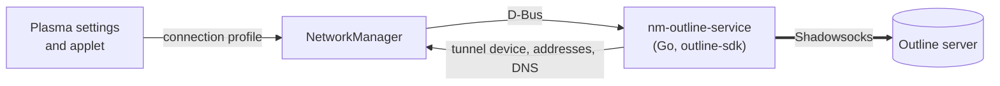

<p align="center">
  <picture>
    <source media="(prefers-color-scheme: dark)" srcset="data/icons/nm-outline-dark.svg">
    
  </picture>
</p>

<h1 align="center">network-manager-outline</h1>

<p align="center">
  Connect to <a href="https://getoutline.org">Outline</a> servers from the KDE Plasma network settings.<br>
  No Outline client needed.
</p>

<p align="center">
  <a href="https://launchpad.net/~a13xcrack/+archive/ubuntu/network-manager-outline"></a>
  <a href="https://github.com/alexcrack/network-manager-outline/releases/latest"></a>
  <br>
  
  
  
  
</p>

---

A NetworkManager VPN plugin built on
[outline-sdk](https://github.com/OutlineFoundation/outline-sdk). Paste or import
an Outline access key, and the connection appears in System Settings and the
network applet like any other VPN.

## Features

- **Native Plasma integration.** "Outline VPN" in *System Settings → Wi-Fi &
  Networking*, connect and disconnect from the panel applet.
- **Access keys as you get them.** Paste a key or import a `.txt` file
  containing one. Static `ss://` keys (Outline, SIP002 and legacy formats) and
  dynamic `ssconf://` keys, fetched from your provider on every connect.
- **Secure key storage.** Store the key in KWallet for your user, system-wide,
  or be asked every time.
- **Everything through the tunnel.** IPv4, IPv6, DNS (no leaks to other links)
  and UDP when the server supports it, with automatic DNS-over-TCP fallback when
  it does not.
- **Stays connected when you switch networks**, without leaking traffic
  while the new network comes up.
- **Clear errors.** A wrong key is reported as a login failure; an unreachable
  server as a connection failure.
- **Works with `nmcli`** too, no GUI required.

## How it works



`nm-outline-service` opens a TUN device and carries its traffic through
outline-sdk's userspace network stack to the Outline server. NetworkManager
does the rest: addresses, routes (including a route to the server that
bypasses the tunnel), DNS through systemd-resolved, and clean teardown.

## Requirements

- Linux with NetworkManager 1.54 and systemd-resolved
- KDE Plasma 6 for the settings UI (tested on Plasma 6.6.6, Ubuntu 26.04)
- To build: Go 1.25+, a C compiler, CMake, Qt 6 and KF6 development packages

## Installation

### From the PPA (recommended)

Packages for Ubuntu 22.04, 24.04 and 26.04 are in the Launchpad PPA
[ppa:a13xcrack/network-manager-outline](https://launchpad.net/~a13xcrack/+archive/ubuntu/network-manager-outline):

```sh
sudo add-apt-repository ppa:a13xcrack/network-manager-outline

# Ubuntu 26.04 with KDE Plasma 6: the service and the Plasma plugin
sudo apt install network-manager-outline plasma-nm-outline

# Ubuntu 22.04 and 24.04 (Plasma 5): the service only, use it with nmcli
sudo apt install network-manager-outline
```

If "Outline VPN" doesn't show up in System Settings right away, restart
NetworkManager (`sudo systemctl restart NetworkManager`) and reopen System
Settings.

`plasma-nm-outline` is built for one plasma-nm version (see the note below),
so apt may hold back a plasma-nm update until a matching release is in the
PPA.

The `.deb` files are also attached to each
[GitHub release](https://github.com/alexcrack/network-manager-outline/releases),
with a `~ubuntu<version>` suffix (shown as `.ubuntu<version>`) for each
Ubuntu release.

### Building Debian packages yourself

```sh
sudo apt install debhelper golang-go   # plus anything `dpkg-checkbuilddeps` lists
make deb
sudo apt install ./dist/network-manager-outline_*.deb ./dist/plasma-nm-outline_*.deb
```

This builds two packages: `network-manager-outline` (the service) and
`plasma-nm-outline` (the Plasma plugin). See
[docs/packaging.md](docs/packaging.md).

### From source

```sh
# Build dependencies (Ubuntu)
sudo apt install golang gcc make cmake extra-cmake-modules libnm-dev \
    qt6-base-dev libkf6networkmanagerqt-dev libkf6i18n-dev \
    libkf6coreaddons-dev libkf6widgetsaddons-dev

# Service
make
sudo make install
sudo systemctl restart NetworkManager   # first install only

# Plasma plugin
make plasma
sudo make install-plasma
```

Build as your user and install as root: the install targets never build,
because sudo's `PATH` usually has no `go`. `sudo make uninstall` removes
everything; `PREFIX` and `DESTDIR` work as usual.

> [!IMPORTANT]
> The Plasma plugin links plasma-nm's internal editor library, which has no
> stable ABI, so it only works with the plasma-nm version it was built for.
> The `plasma-nm-outline` package is pinned to that version. After a plasma-nm
> upgrade, rebuild the plugin (`make deb`, or `make plasma && sudo make
> install-plasma`). See [docs/plasma-plugin.md](docs/plasma-plugin.md).

## Usage

### In Plasma

1. Open *System Settings → Wi-Fi & Networking*, click **+** and choose
   **Outline VPN**.
2. Paste your access key and save. Or choose **Import VPN connection…** and
   pick a `.txt` file containing the key.
3. Connect from the network applet in the panel.

### With nmcli

```sh
read -rs KEY        # paste the key, then Enter; keeps it out of shell history
nmcli connection add type vpn vpn-type outline con-name outline vpn.secrets "access-key=$KEY"
unset KEY
nmcli connection up outline
```

### Settings

| Setting | Values | Default |
|---|---|---|
| Access key (`access-key` secret) | `ss://…`, or a dynamic `ssconf://…` / `https://…` key | required |
| DNS servers (`dns`) | IPv4/IPv6 addresses, separated by commas or spaces | `1.1.1.1` |
| IPv6 (`ipv6`) | `tunnel` (through the VPN), `off` (bypasses it) | `tunnel` |
| Default route (`never-default`) | `yes` keeps other traffic off the VPN | `no` |
| Transport prefix (`transport-prefix`) | outline-sdk prefix for TCP, e.g. `split:2`, `tlsfrag:1` | none |
| Stay connected when the network changes (`vpn.persistent`, not in `vpn.data`) | `yes`, `no` | `yes` in Plasma, `no` in nmcli |

With nmcli, set them as `vpn.data`. nmcli separates items with commas, so
separate several DNS servers with spaces:

```sh
nmcli connection modify outline vpn.data "dns=9.9.9.9 149.112.112.112, ipv6=off"
```

To stay connected when the network changes, as Plasma does by default:

```sh
nmcli connection modify outline vpn.persistent yes
```

### Troubleshooting

```sh
journalctl -u NetworkManager -b | grep -i outline
```

The service logs each connection step. Access keys are never logged.

## Development

Pull requests are checked by CI (lint and tests); packages, releases and the
Launchpad PPA are made by manual workflows. See [docs/ci.md](docs/ci.md).

```sh
make lint          # golangci-lint, as in the PR check
make test          # Go tests, including D-Bus tests against a private dbus-daemon
make plasma-test   # loads the built Plasma plugin offscreen and tests it
make icons         # regenerates the SVG and PNG icons (needs inkscape for the PNGs)
```

The TUN test needs root and is skipped otherwise:

```sh
go test -c -o bin/tun.test ./internal/tun && sudo bin/tun.test -test.v
```

<details>
<summary>Repository layout</summary>

| Path | Purpose |
|---|---|
| `cmd/nm-outline-service` | Service entry point |
| `internal/nmvpn` | Pure-Go `org.freedesktop.NetworkManager.VPN.Plugin` D-Bus implementation |
| `internal/outline` | Access keys, settings, outline-sdk stack, connection flow |
| `internal/tun` | TUN device |
| `plasma/` | Plasma (plasma-nm) VPN plugin, Qt 6 / KF6 |
| `data/` | NetworkManager `.name` file, D-Bus policy, icons |
| `docs/` | Plan, architecture, protocol reference |
| `debian/` | Debian packaging |
| `gnome/` | Placeholder for GNOME support |

</details>

## Documentation

- [Plan and status](docs/plan.md): roadmap, decisions, test results
- [Architecture](docs/architecture.md): components, connection lifecycle, routing and DNS
- [NetworkManager VPN D-Bus protocol](docs/nm-vpn-dbus-protocol.md): as implemented, verified against NetworkManager 1.54.3
- [Plasma plugin](docs/plasma-plugin.md): how it is built and why it must be rebuilt after upgrades
- [Packaging](docs/packaging.md): Debian packages and plasma-nm version pinning
- [CI and releases](docs/ci.md): workflows, release process, Launchpad PPA setup

## Roadmap

- [x] Service with `nmcli`
- [x] Plasma plugin
- [x] Dynamic `ssconf://` keys
- [x] Stay connected when the network changes
- [x] Debian packages
- [x] CI and Launchpad PPA releases
- [ ] GNOME support

## License

- The service and everything outside `plasma/`: [Apache License 2.0](LICENSE),
  like outline-sdk.
- The Plasma plugin in `plasma/`: [GNU GPL v2 or later](plasma/LICENSE),
  because it links plasma-nm.
